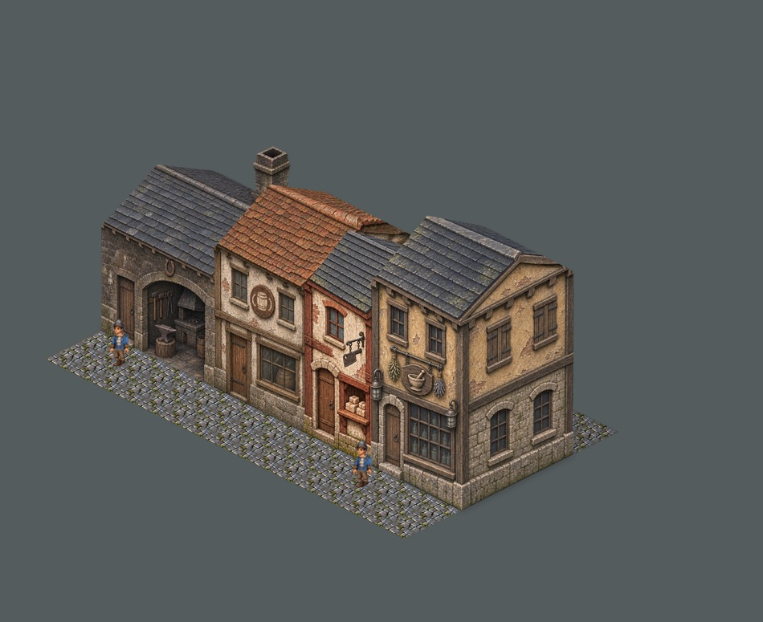
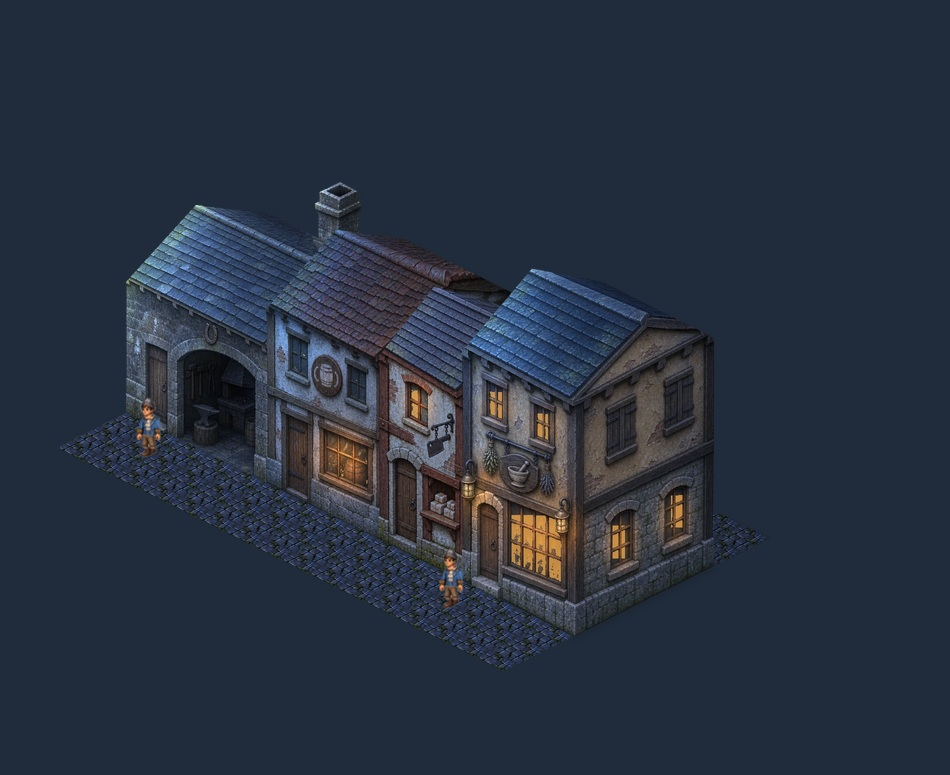

# Artisan street art v1

Four additional city premises: a low working smithy, cooper, narrow butcher shop and apothecary. Candidate art for review; local plot arrangement, world site and integration still need review. This packet changes no runtime game files.

| Premises | Local plot (x,y,w,d) | Human door at game scale |
|---|---|---|
| smithy | 0, 3, 5, 5 | 70.1 px |
| cooper | 5, 3, 4, 5 | 70.2 px |
| butcher | 9, 4, 3, 4 | 70.1 px |
| apothecary | 12, 3, 4, 5 | 70.0 px |

Each world axis advances 28 pixels horizontally and 14 vertically. Textures are 2× source resolution and draw at 0.5. Existing 60 px Watch figures appear in the review scenes for scale only. The smithy is single storey; the three shops have two storeys.

## Layers and placement

Each building has day, night, roof, roof-night, walls, walls-night and emission WebPs. All variants share a crop and anchor. Roof removal exposes the exterior wall shell; furnished interiors are outside this delivery. Night light is already baked into the night sprites. Emission layers identify existing glass and lantern panes for shaders; do not add the same light twice.

registration.json supplies texture sizes, nativeOrigin, nativeAnchor at the front corner, face geometry and measured human doors. Draw top-left at the projected plot origin minus nativeOrigin×0.5. layout.json supplies the local plots, street paving, rear lane and proposed entrances. The paving and shadows use layout.terrain.nativeOrigin at the same 0.5 draw scale. Keep street paving clear for patrol movement. Decode either a full sprite or its roof/wall pair as needed, and load distant variants later; the review JPEGs are not runtime assets.

## Validation

qa.json records door heights, mathematical foundation/eave/ridge directions, actual raster foundation directions and matching day/night alpha for full sprites, roof and wall layers. Window masks remain within wall alpha. Inspect grid-layout.png alongside both street reviews. Geometry and asset registration are checked; world placement, navigation and physical-phone performance await integration.

Painted studies were generated from exact footprint guides and existing shipped art, then registered by facade and roof plane. Night illumination was transferred to the registered pixels to preserve their silhouettes. prompts.json records generation prompts and reference roles. The smithy chimney is a separately registered part of the roof layer. WebPs preserve lossless alpha. Building variants retain their shared 1300 × 1400 source canvas; paving and shadows have a registered crop.

The city art review index at docs/art/CITY-ART-REVIEW-INDEX.md links the preceding deliveries and distinguishes approved day art from newer candidates.

Completed 20 November 2026: butcher night and walls-night, four night roof layers, night street preview and qa.json. All previously missing companion files are now supplied. This completes the artwork packet; creative approval and runtime integration remain pending.
