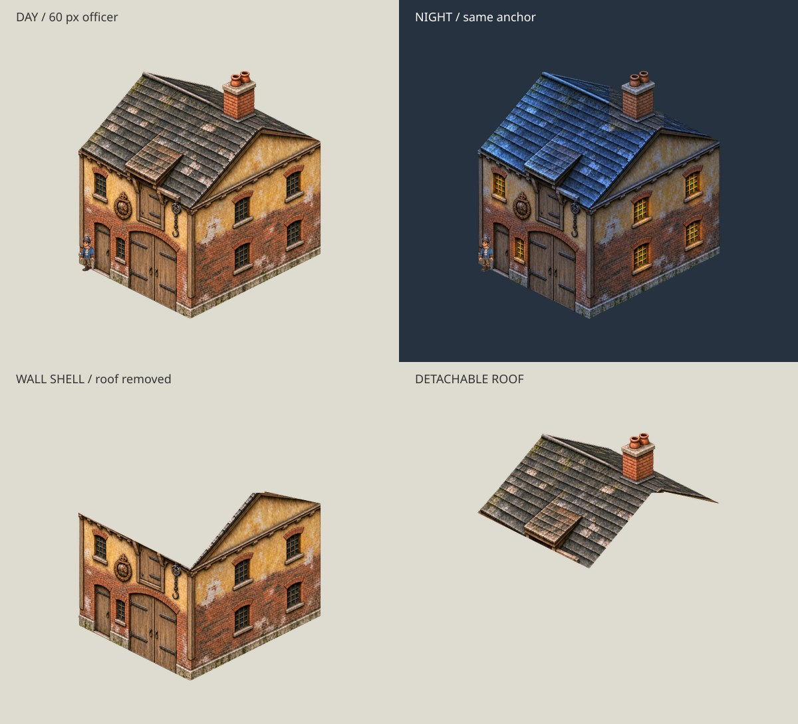

# Cooper workshop — prepared art packet

Prepared from Mark's Midjourney painting on 20 November 2026. This is a new
candidate alongside the earlier artisan-street cooper; it does not replace an
approved design or change the live game.



## Included production layers

`cooper-day.webp`, `cooper-night.webp`, `cooper-roof.webp`,
`cooper-roof-night.webp`, `cooper-walls.webp`, `cooper-walls-night.webp`
and `cooper-emission.webp`. The downloadable pack also contains transparent PNG
mirrors, source studies, the original Midjourney JPEG and the export script.

All seven layers share an **896 × 1024** canvas. Draw at **0.5** scale. Native
front foundation anchor: **[420,900]**. Native local plot origin: **[476,536]**.
For a proposed **6 × 7** cell footprint, draw the image top-left at projected
plot origin minus `[238,268]`. Full day/night silhouette and roof/wall companion
alpha are identical. Roof plus walls reconstruct each full sprite exactly.

The small human entrance measures **70.22 px** at drawing scale beside the
60 px officer. The large doors are cart/loading doors. This is a sizeable
two-storey workshop; do not shrink it to the dimensions of the earlier small
artisan-street cooper.

The foundation was independently measured from the final raster: left
**26.5659°**, right **26.5651°**. Transparent margins are at least **84 px**;
there is no grey backdrop or soft halo. Windows remain dark in the day sprite.
The night version supplies cool moonlight and warm existing window glass.
Emission pixels remain inside the wall shell. The night sprite is prelit;
avoid adding its emission a second time without compensating the blend.

`registration.json` records source/target wall and roof plane vertices, the
door measurement and placement origin. `qa.json` records final file checks.
The supplied wall shell is an exterior cutaway, **not a furnished interior**.

## Preparation and limits

The built-in image tool removed the original background, restored roof margins,
painted a night lighting study and repaired the chimney. Production exports
register wall/roof planes to the city grid. Low-frequency night illumination
is applied to the registered day pixels so textures and geometry do not jump
between times of day. The chimney repair is confined to the upper roof patch.

Reproduce with Node and Sharp, using the source studies in the downloadable pack:

```
node tools/make-cooper-workshop.cjs art-review/cooper-workshop-v1/sources/day-study.png art-review/cooper-workshop-v1/sources/night-study.png art-review/cooper-workshop-v1/sources/chimney-repair.png
```

The roof source is fitted by plane, so a visual review is still needed before
creative approval. No world plot, entrance interaction, collision or runtime
lighting has been installed. No gameplay or physical-phone verification is
claimed. The review scene is an art composition at proposed game scale.
