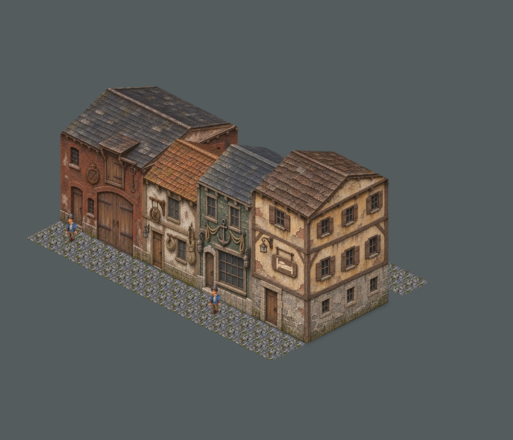
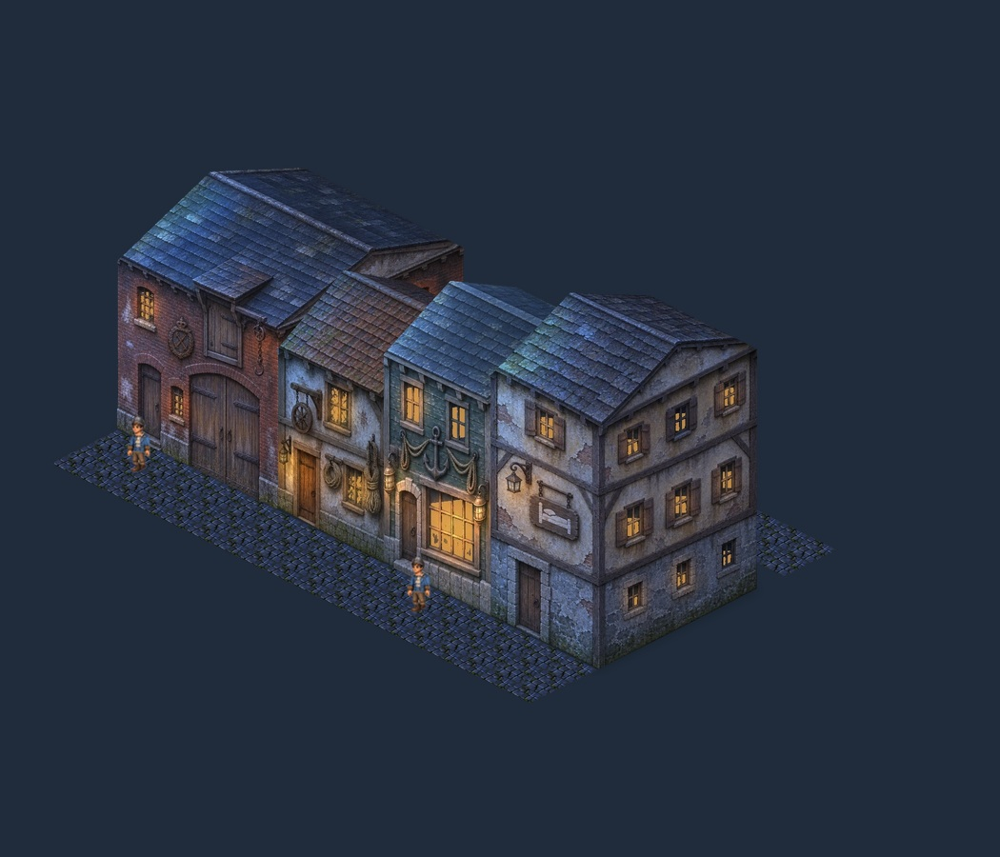

# Dockside street art v1

Four additional dock premises, supplied as candidate art for review. No runtime map, collision, entrance script or live build changes are included. This local arrangement still needs a world site and an integration pass.

| Premises | Local plot (x,y,w,d) | Eaves at game scale | Human door |
|---|---|---|---|
| bonded-warehouse | 0, 2, 6, 7 | 176.6 px | 70.0 px |
| rope-maker | 6, 4, 4, 5 | 168.2 px | 69.8 px |
| ship-chandler | 10, 4, 4, 5 | 219.1 px | 70.1 px |
| quay-lodging | 14, 3, 4, 6 | 252.5 px | 70.0 px |

Projection: each world axis advances 28 px horizontally and 14 px vertically. Building textures are supplied at 2× source resolution and draw at 0.5. Door scale is calibrated against the existing 60 px Watch character in both review scenes. The taller chandler has a high shop storey; the lodging has three floors.

Each building includes day, night, roof, roof-night, walls, walls-night and emission WebPs. Roof removal exposes an exterior wall shell; interior rooms are outside this packet. Day/night alpha is identical. Emission maps select the existing glass and lantern panes and remain inside wall alpha. They can be used by a lighting shader; the night sprite already contains the warm windows, so avoid adding the mask a second time.

The rope-maker also has a separate 4×2 working-yard sprite with day/night versions, bench, rope and fencing. Its gate faces the rear lane. It is naturally hidden behind the premises in the assembled front view: see yard-review.jpg and grid-layout.png.

## Placement

Use registration.json for cropped texture sizes, nativeOrigin, front-corner nativeAnchor, face geometry and measured doors. NativeOrigin is the image position of local plot coordinate (0,0). Draw top-left at projected plot origin minus nativeOrigin×0.5. All variants of a building share its origin and crop.

layout.json records the proposed plots, clear quay paving strip, rear lane, yard and candidate entrance positions. yard-registration.json supplies the yard origin. Shared paving and contact shadows use layout.terrain.nativeOrigin with the same 0.5 draw scale. The reference characters appear only in the JPEG review scenes.

## Verification

qa.json records door measurements, 26.565° foundation and ridge directions, alpha equality, window-mask containment and decoded sizes. Asset geometry and image registration have been checked; world placement, gameplay navigation and mobile performance require integration testing.

Generated painted studies were registered by facade and roof plane, then night illumination was transferred to the registered pixels to preserve the outline. Palette references: dockside-001 warehouse, rope-house and lodging; landmark-exteriors-v1 bakery. Existing cobble texture and Watch character are used for review context. Runtime sprites use cropped WebP textures with lossless alpha.
