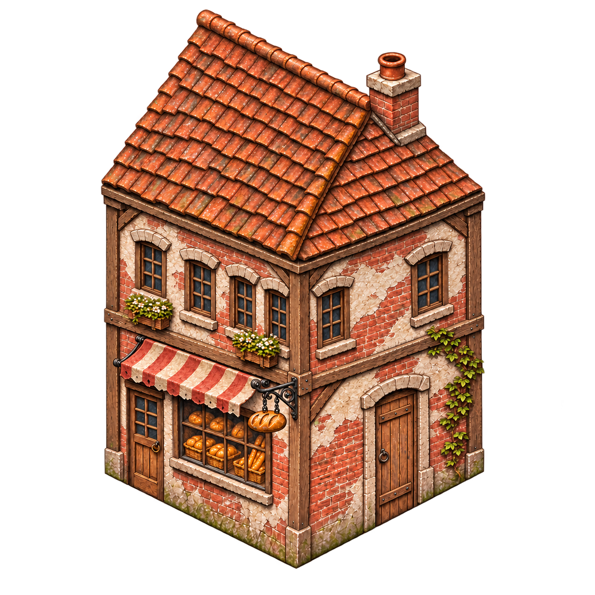
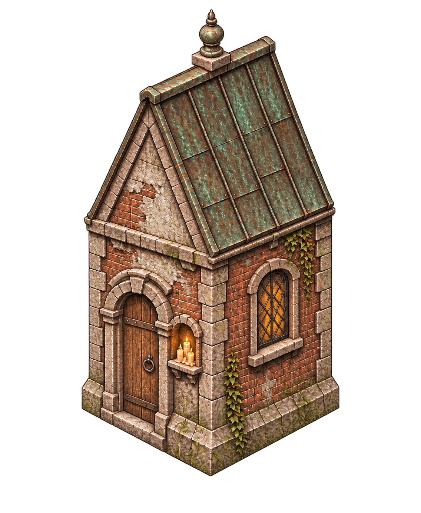
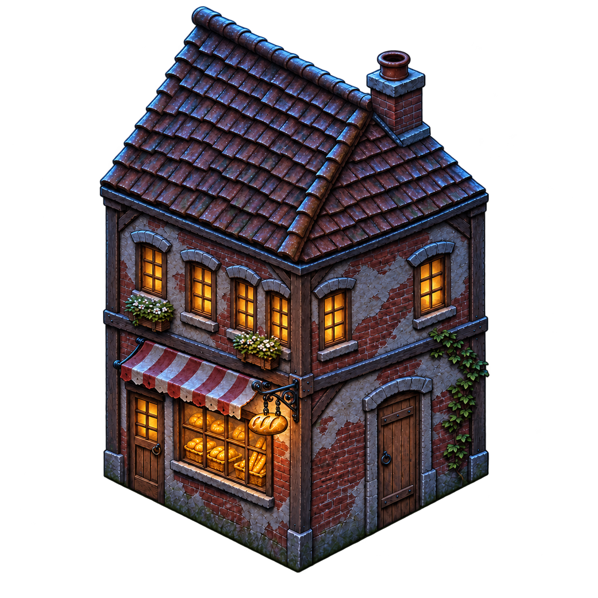
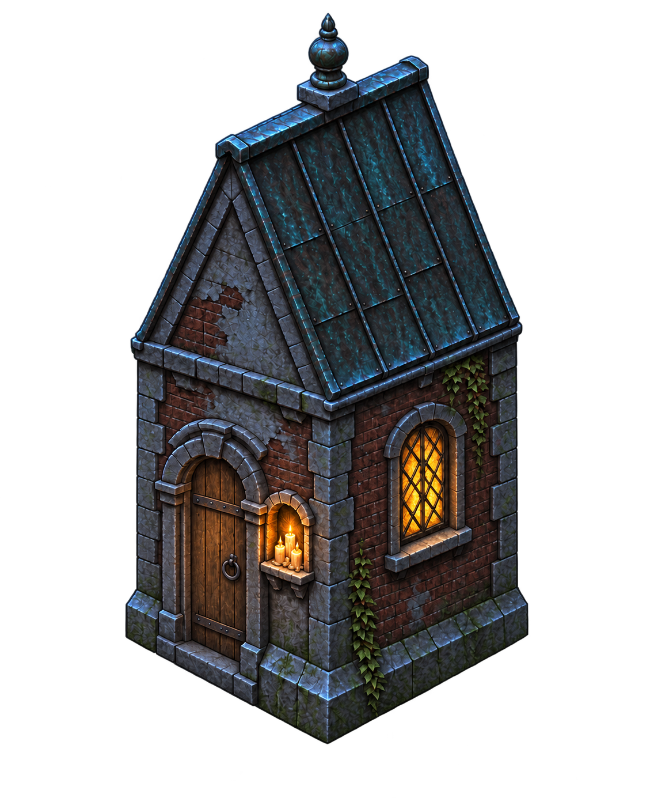
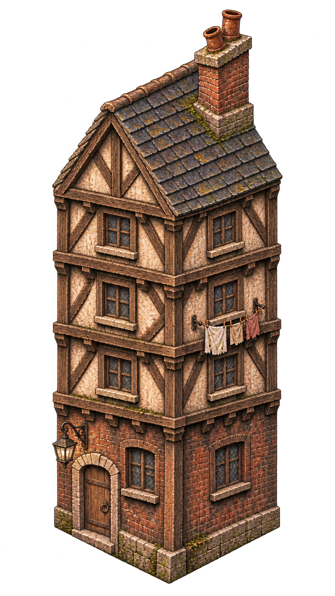
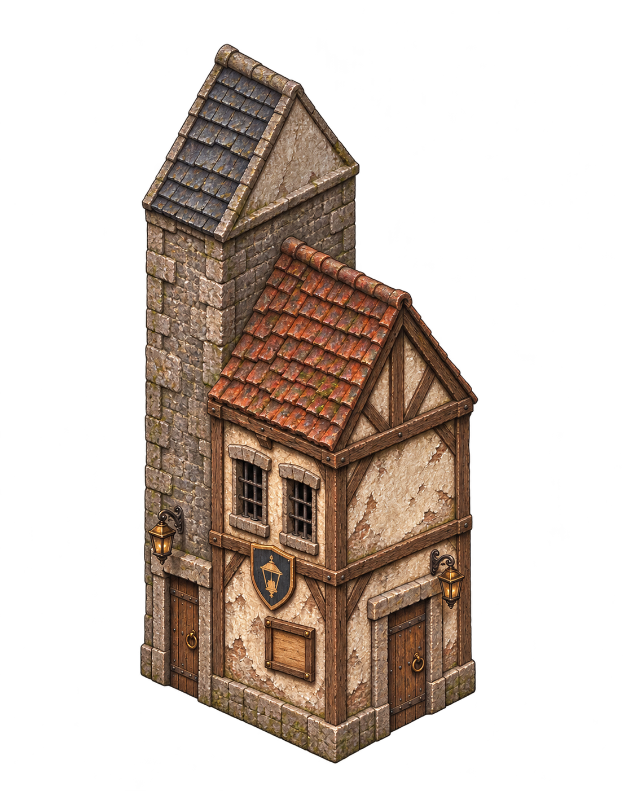
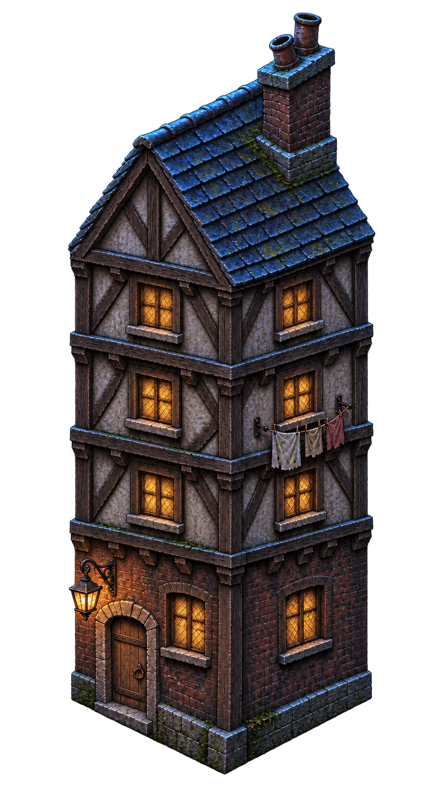
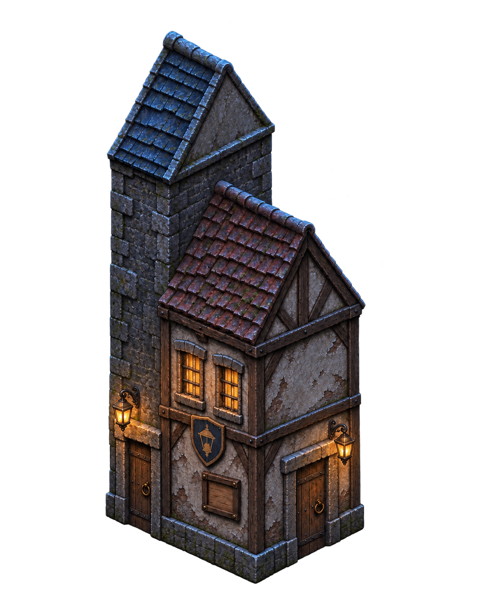

# Final four landmark exteriors — 21 November 2026

New bakery, Wayside Shrine, Crooked Alley House and Watch Outpost paintings, each with a day sprite and a night lighting companion. Created from the exact-angle blockouts in `docs/art/midjourney/refs/` and the approved Mended Drum/Archives style references. Generated with the built-in image tool; projection revisions were made with the same tool. Exported losslessly to transparent WebP, preserving original PNG sources.

**Status: proposed for visual review. Not integrated or creatively approved.** No `dist/` files change.

| Building | Day | Night | Measured daytime foundation angles |
|---|---|---|---|
| Bakery | [day](bakery-day.webp) | [night](bakery-night.webp) | 26.467° / 27.317° |
| Wayside Shrine | [day](shrine-day.webp) | [night](shrine-night.webp) | 27.656° / 28.007° |
| Crooked Alley House | [day](alley-day.webp) | [night](alley-night.webp) | 26.387° / 27.246° |
| Watch Outpost | [day](outpost-day.webp) | [night](outpost-night.webp) | 24.924° / 26.488° |

All eight daytime foundation edges fall within 2° of the 26.565° target. These are measured raster-contour fits, **not mathematically exact 2:1 drawings**. The gate tolerance is the 1–2° tolerance in the current four-landmark brief. Different foundation spans in the outpost reflect the joined tower/guardroom footprint.

## Review

Open [review.html](review.html) from a local copy for day/night, pale/dark/cobble backgrounds, adjustable draw size, a 60px figure and a 28×14px reference diamond. Initial scales are illustrative only; use the doorway bracket control to check human-door height before site fitting. This is an asset review page, not gameplay evidence.

| Bakery | Shrine |
|---|---|
|  |  |
|  |  |

| Alley house | Watch outpost |
|---|---|
|  |  |
|  |  |

## Exact delivery and checks

- `<building>-day.png`, `<building>-night.png`: unmodified selected generated sources.
- Matching `.webp` files: lossless RGBA exports; decoded RGBA equals each PNG exactly.
- [registration.json](registration.json): per-image source dimensions, front/bottom anchor, measured foundation points, fitted slopes, SHA-256 and day/night silhouette overlap.
- [qa.json](qa.json): image checks and explicit limitations.
- [prompts.md](prompts.md): geometry, design and night instructions used for this packet.
- `python verify.py`: recheck decoding, checksums, transparency and lossless exports.

## Integration handoff / remaining work

These are exterior **art candidates**, not drop-in runtime replacements. Day/night images have small outline shifts (and the alley night canvas is one pixel shorter): they are **not pixel-locked**. Separate anchors are supplied; register each night painting to the day silhouette before a seamless lighting transition. Do not claim identical alpha. No raw asset resizing, reprojection, colour cleanup or alpha edits were applied during packaging.

Fit each building so human doorways are 65–75px beside the 60px officer, then validate the foundation footprint and street clearance against the actual site. The shrine is especially narrow relative to its door: do not stretch it to fill a square plot. Keep the tower/guardroom compound footprint for the outpost.

Roof/wall cutaways, isolated emissions, furnished interiors, site/door integration and physical-phone screenshots remain subsequent integration work. These drawings have no in-game placement, collision or phone-performance sign-off.
