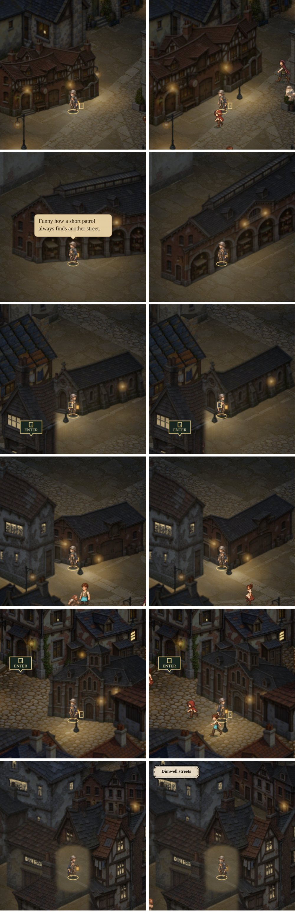
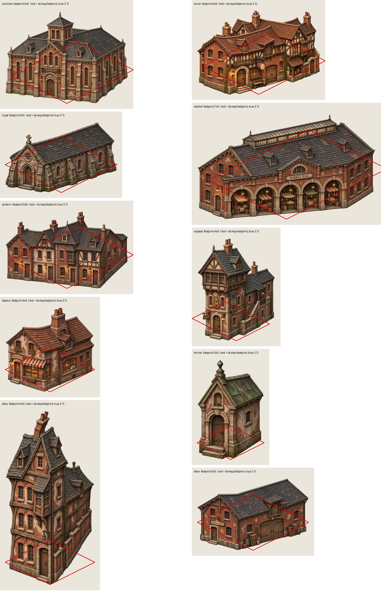

# Landmark buildings: angle and size check (19 November 2026)

Mark rejected the Mended Drum for being too small and off angle, then asked for the
same check on every landmark building. This covers the ten buildings in
`dist/assets/landmark-exteriors-v1/`.

## Update, 19 November 2026: six buildings re-angled in the game

The art team has left, so instead of redraws the six off-angle buildings were corrected
with `tools/reangle-landmarks.py`. It moves each column of the picture up or down (walls
stay upright, nothing is repainted) so the base runs at 2:1 on both sides, with the front
corner left where it was. The results are in `dist/assets/landmark-exteriors-v2/`, which
the game now loads. The originals stay in `landmark-exteriors-v1/`.

- Mended Drum, Market Hall, Crypt, Storehouse, Lantern row and Archives: base now 26–27°
  on both sides (`tools/audit-landmark-angles.py`).
- The Mended Drum is also drawn 25% larger (5/6 of its file size instead of 2/3, still a
  reduction, so no blur). Its doors come out about 81 px tall next to 60 px characters.
  Its space on the map is unchanged: walking and doors are as before.
- The Archives changes the most. Its front used to face the viewer and now runs along the
  street; keep an eye on whether Mark prefers it.
- Roof lines bend slightly where a side was tilted a lot. A real redraw would still be
  better, but these sit on the street grid.

Before (left) and after (right), in the game:

## Original check

In `landmark-footprints-original.png` (and `landmark-footprints.png` for the current art), each building is shown at its file size. The red diamond is
its footprint on the map, drawn at the game's true 2:1 isometric angle: ground lines rise
1 pixel for every 2 across (26.6°), from the foot point the game stands the building on.
A building that fits the map sits on its diamond, with its walls running along the red lines.

## How each building measures up

"Base angles" are measured along the foot of the art (left side / right side). They
should both be about 27°. Steps, plants and shadows at the foot make the numbers rough
(a few degrees either way), so the verdict also comes from the overlay.

| Building | File | Drawn in game | Footprint (cells) | Base angles L / R | Verdict |
|---|---|---|---|---|---|
| Mended Drum (`drum`) | 462 × 316 | 308 px wide | 5 × 6 | 20° / 13° | **Redo: off angle, too small** (Mark). Walls far shallower than the map; the building spills left of its footprint. |
| Market Hall (`market`) | 672 × 399 | 448 px | 7 × 9 | 28° / 6° | **Redo: off angle.** Faces the viewer almost flat-on; the long arcade front runs near horizontal and the hall overhangs its footprint on the left. |
| Archives (`archives`) | 462 × 349 | 308 px | 5 × 6 | 6° / 38° | **Redo: off angle.** Front faces the viewer; the side wall is too steep. Doesn't sit on its diamond. |
| Lantern row (`lantern`) | 462 × 291 | 308 px | 5 × 6 | 6° / 45° | **Redo: off angle.** Street front almost flat; reads as a front elevation, not isometric. |
| Crypt (`crypt`) | 420 × 265 | 280 px | 5 × 5 | 10° / 18° | **Off angle.** The nave runs too shallow. |
| Storehouse (`store`) | 420 × 271 | 280 px | 5 × 5 | 12° / 15° | **Off angle.** Both walls too shallow; the building is wider than its footprint. |
| Watch outpost (`outpost`) | 294 × 386 | 196 px | 4 × 3 | 28° / 24° | Angle close. The building stands up and left of its footprint, so its foot point needs checking. |
| Bakery (`bakery`) | 336 × 318 | 224 px | 4 × 4 | 16° / 23° | Slightly shallow; acceptable for now. |
| Shrine (`shrine`) | 252 × 376 | 168 px | 3 × 3 | 11° / 28° | Close (the step pulls the left figure down); acceptable. |
| Alley house (`alley`) | 336 × 655 | 224 px | 4 × 4 | 22° / 55°\* | Close. \*The right figure is thrown by the side wall and yard; the overlay fits. |

## Size

Every landmark is drawn at 2/3 of its file size, so that its width matches its footprint
exactly (28 px per cell of footprint width plus depth). Doors come out about 65 px tall
next to 60 px characters. So each building's size on screen is set by its footprint, and
a building looks small because its footprint is small:

- The Mended Drum has a 5 × 6 footprint, the same as the Archives and the Lantern row,
  and smaller than the Market Hall (7 × 9). For the city's best-known tavern, Mark judged
  that too small.
- Making a building bigger means a bigger footprint on the map (moving its door point
  and checking the neighbouring buildings and street), plus art drawn for that footprint.

## Brief for the art team (redraws)

Priority: Mended Drum, Market Hall, Archives, Lantern row, then Crypt and Storehouse.

1. True 2:1 isometric, matching the street grid: every ground line and wall base rises
   1 px per 2 px across (26.6°), on both sides.
2. The building's front corner sits on the footprint's front corner (the foot point),
   and its walls run along the footprint's edges, as in the red diamonds above.
3. Mended Drum: draw for a larger footprint. Agree the new footprint with Mark first
   (for example 7 × 8, close to the Market Hall). Deliver at the size the game draws it
   (28 px per footprint cell across), or at exactly 1.5× that, as now.
4. Keep the current look (brick, timber, signs, lamps). These redraws are about angle,
   footprint and size, not style.

Rerun the measurement with `tools/audit-landmark-angles.py` (current art) or
`tools/audit-landmark-angles.py dist/assets/landmark-exteriors-v1/` (the originals).
